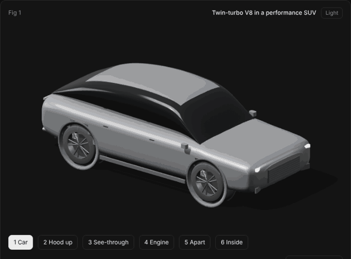
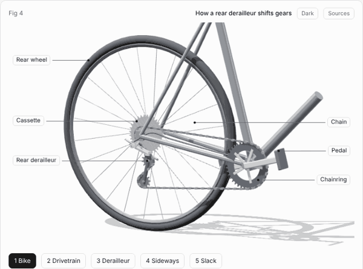
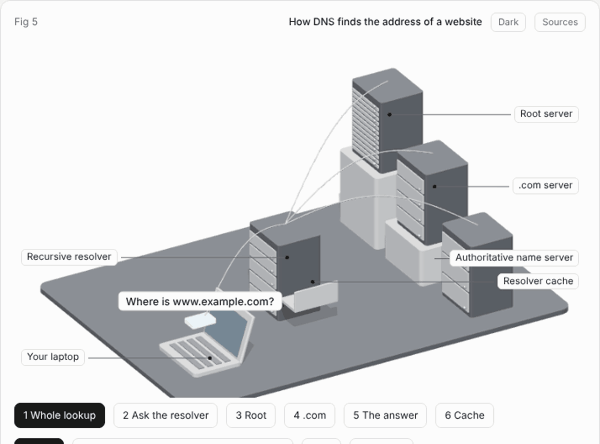
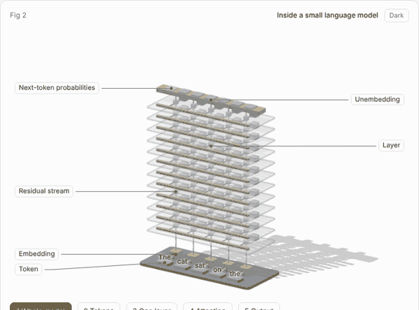
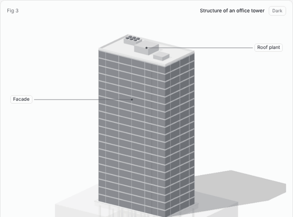
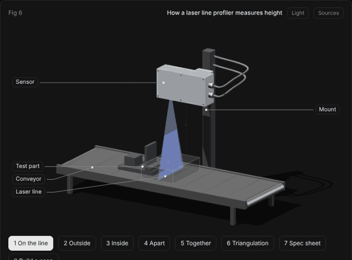

# mech

**An agent skill that builds interactive 3D figures to show and teach how things work.**

You ask your AI agent "show me how a dishwasher works". The agent follows this skill and gives you one HTML page: a 3D model that you can open up stage by stage, with labels, part info, a guided lesson and a live readout. It works for machines, buildings, abstract systems (a language model) and conversations between systems (DNS).

Every picture below is a figure that the skill made.

## Gallery

Each picture links to the live figure. Open one, step through the stages, and click the parts.

| | |
|---|---|
| [](https://auswallace.github.io/mech/examples/v8-suv/) | [](https://auswallace.github.io/mech/examples/derailleur/) |
| Twin-turbo V8 in an SUV | How a rear derailleur shifts |
| [](https://auswallace.github.io/mech/examples/dns/) | [](https://auswallace.github.io/mech/examples/llm/) |
| How DNS finds an address | Inside a small language model |
| [](https://auswallace.github.io/mech/examples/tower/) | [](https://auswallace.github.io/mech/examples/gocator/) |
| Structure of a 20-storey tower | How a laser line profiler measures height |

## Examples

- `examples/v8-suv`: a twin-turbo V8 in a performance SUV. Six stages from the whole car to the pistons and valves, a lesson on the four strokes, air and exhaust flow, and a quiz. The engine follows the published layout of a 4.0 litre, 90 degree, twin-turbo V8. The body is an original, generic shell.
- `examples/tower`: the structure of a 20-storey office tower. Slabs, beams, columns, core, lifts and piled foundation, a slider that builds it storey by storey, and the paths of weight and wind.
- `examples/derailleur`: how a rear derailleur shifts gears. Toothed cogs, a chain that follows a solved path, a parallelogram that swings, and a cage whose angle keeps the chain length constant. It carries a sourced facts list and 33 model checks.
- `examples/dns`: how DNS finds the address of a website. Five stations, eight readable messages, a cache that fills and expires.
- `examples/gocator`: how a laser line profiler turns a laser line into heights, with the Gocator 2630 as the reference model. Eight stages from the sensor on a conveyor to the parts apart and back together, a height slider that moves the line on the image chip, the spec sheet terms drawn at full size, and a scan that builds up profile by profile. Two lessons: one measurement from laser to result, and a build with one step for each component. The data sheet numbers are sourced. The housing is generic, and the internal layout is marked illustrative.
- `examples/llm`: the inside of a small language model. Tokens, embeddings, 12 layers of attention and MLP, and the next-token output, with the sizes of GPT-2 small.

Every figure has labels, click-to-learn part info, a guided lesson and a light and dark theme. The newer ones also have a Sources button that shows where each fact comes from.

## Use the skill

1. Clone this repository into the folder that your agent reads skills from, with the name `mech`: `git clone https://github.com/auswallace/mech <skills folder>/mech`.
2. Ask for a figure. Name the skill the first time:
   - "Use mech to show me how a pin-tumbler lock opens."
   - "Use mech to show me inside a jet engine."
   - "Use mech to show me how a TLS handshake works."
3. Answer three short questions: how deep, who it is for, and what matters most.
4. The agent looks up the facts, builds the figure, checks it with screenshots, and gives you the HTML page.

The agent needs Node to build a figure. It needs Python, Playwright and Chrome to check one.

## What a figure gives you

- Stages that go from the whole object to the mechanism inside it.
- Labels, and part info when you click a part or its label: what it is, what it does, how, and where the facts come from.
- A guided lesson that moves the model step by step.
- A readout with numbers that come from the same model that drives the motion.
- A Sources button that shows where each fact comes from.
- A realistic look and a line-drawing look, in light and dark.

## Build the examples yourself

```sh
npm install
node scripts/build.mjs examples/v8-suv          # writes examples/v8-suv/index.html
node scripts/build.mjs examples/v8-suv --light  # light theme
python3 scripts/capture.py examples/v8-suv/index.html shots   # screenshots and audit of each stage
python3 scripts/gif.py examples/dns/index.html docs/dns.gif "0:90"   # animated preview
```

Open `index.html` in a browser. Number keys change stage, Space goes to the next stage, drag to orbit, click a part to learn what it does.

## Layout

- `SKILL.md`: the workflow and rules
- `kit/mech.js`: the renderer and parts
- `scripts/build.mjs`, `scripts/capture.py`, `scripts/gif.py`: build, check, record a preview
- `references/`: subject types, teaching layer, kit reference, craft notes, lessons learned
- `template/`: an empty scene to start from
- `evals/`: test prompts with pass criteria
- `ROADMAP.md`: what is done and what is next
- `examples/`: worked figures

MIT license.
