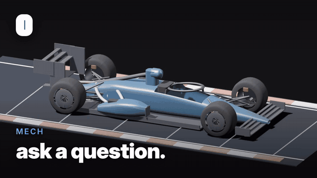
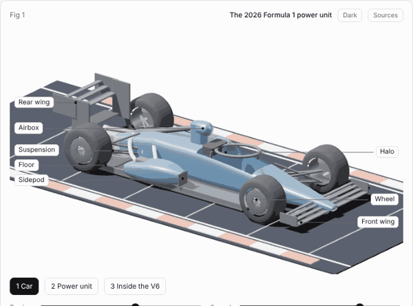
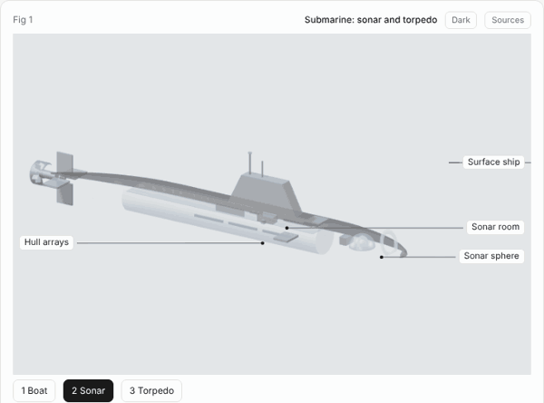
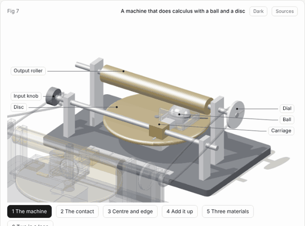

# mech

**A skill that lets an AI assistant build interactive 3D figures that show and teach how things work.**

You ask "show me how a dishwasher works". The assistant follows this skill and gives you one HTML page: a 3D model that you can open up stage by stage, with labels, part info, a guided lesson and a live readout. It works for machines, buildings, and ideas with no physical shape, such as a language model or a DNS lookup.

[](https://auswallace.github.io/mech/docs/demo.mp4)

Type `/mech` and a question. Every shot here is a real figure. Click for the full video.

## Gallery

Every picture below is a figure that the skill made. Each one links to the live figure. Open one, step through the stages, and click the parts.

| | |
|---|---|
| [](https://auswallace.github.io/mech/examples/f1-power-unit/) | [](https://auswallace.github.io/mech/examples/derailleur/) |
| The 2026 Formula 1 power unit, in a car that drives | How a rear derailleur shifts |
| [](https://auswallace.github.io/mech/examples/gocator/) | [](https://auswallace.github.io/mech/examples/dns/) |
| How a laser line profiler measures height | How DNS finds an address |
| [](https://auswallace.github.io/mech/examples/submarine/) | [](https://auswallace.github.io/mech/examples/llm/) |
| How a submarine finds a target, and inside a torpedo | Inside a small language model |
| [](https://auswallace.github.io/mech/examples/v8-suv/) | [](https://auswallace.github.io/mech/examples/tower/) |
| Twin-turbo V8 in an SUV | Structure of a 20-storey tower |
| [](https://auswallace.github.io/mech/examples/integrator/) | |
| A machine that does calculus with a ball and a disc | |

## Use the skill

A skill is a folder with a `SKILL.md` file that tells an AI assistant how to do one kind of job. mech works with any assistant that loads skills from a folder and can run commands.

1. Clone this repository into the skills folder of your assistant, with the name `mech`:
   ```sh
   git clone https://github.com/auswallace/mech <skills folder>/mech
   ```
2. Ask for a figure. Name the skill the first time:
   - "Use mech to show me how a pin-tumbler lock opens."
   - "Use mech to show me inside a jet engine."
   - "Use mech to show me how a TLS handshake works."
3. Answer three short questions: how deep, who it is for, and what matters most.
4. The assistant looks up the facts, builds the figure, checks it with screenshots, and gives you the HTML page.

A figure takes time. Expect 30 to 60 minutes for a guided lesson on a complex subject, and less for a quick look. Most of that is the assistant looking up facts and checking its own work, and a long build uses a lot of tokens.

The assistant needs Node to build a figure. It needs Python, Playwright and Chrome to check one.

## Why you can trust a figure

A figure that teaches something wrong is worse than no figure. The skill has four guards against that.

- **Every fact has a status.** Sourced with a link, worked out by the model, assumed, or illustrative. The Sources button on the figure shows the full list to the reader.
- **Numbers come from the model.** The readout and the motion read the same values, so they cannot disagree.
- **Model checks.** Each figure tests itself when it loads: a rod keeps its length, a wheel rolls without slipping, a result matches its formula. The derailleur example has 33 checks.
- **An audit before delivery.** The assistant takes a screenshot of every stage and looks for parts that float, labels that point at hidden spots, and facts with no source.

The Sources button and the checks came in with the newer examples. The oldest ones do not have them yet.

## What a figure gives you

- Stages that go from the whole object to the mechanism inside it.
- Labels, and part info when you click a part or its label: what it is, what it does, and how.
- A guided lesson that moves the model step by step.
- A readout that changes as you move the controls.
- A realistic look and a line-drawing look, in light and dark.
- An option to show the subject in motion: a car on a road that scrolls, with wheels that roll.

## Examples

- `examples/f1-power-unit`: the 2026 Formula 1 power unit, in a car that drives.
- `examples/derailleur`: how a rear derailleur shifts gears.
- `examples/gocator`: how a laser line profiler measures height.
- `examples/dns`: how DNS finds the address of a website.
- `examples/submarine`: how a submarine finds a target, and what is inside a torpedo.
- `examples/llm`: the inside of a small language model.
- `examples/v8-suv`: a twin-turbo V8 in a performance SUV.
- `examples/tower`: the structure of a 20-storey office tower.
- `examples/integrator`: a machine that does calculus with a ball and a disc.

[EXAMPLES.md](EXAMPLES.md) has the detail on each one.

## Build the examples yourself

```sh
npm install
node scripts/build.mjs examples/v8-suv          # writes examples/v8-suv/index.html
node scripts/build.mjs examples/v8-suv --light  # light theme
python3 scripts/capture.py examples/v8-suv/index.html shots --audit   # fast audit of each stage, no pictures
python3 scripts/capture.py examples/v8-suv/index.html shots   # screenshots and audit of each stage
python3 scripts/gif.py examples/dns/index.html docs/dns.gif "0:90"   # animated preview
```

Open `index.html` in a browser. Number keys change stage, Space goes to the next stage, drag to orbit, click a part to learn what it does.

## Layout

- `SKILL.md`: the workflow and rules
- `kit/mech.js`: the renderer and parts
- `scripts/build.mjs`, `scripts/capture.py`, `scripts/gif.py`: build, check, record a preview
- `references/`: subject types, teaching layer, kit reference, craft notes, lessons learned
- `template/`: an empty scene to start from
- `evals/`: test prompts with pass criteria
- `ROADMAP.md`: what is done and what is next
- `examples/`: worked figures
- `EXAMPLES.md`: what each example shows

## Limits

A figure is a teaching model, not an engineering drawing. Shapes are simplified, some values are typical and not exact, and motion is slowed so that you can follow it. Each figure states its simplifications in its caption.

## License

MIT. See [LICENSE](LICENSE).
