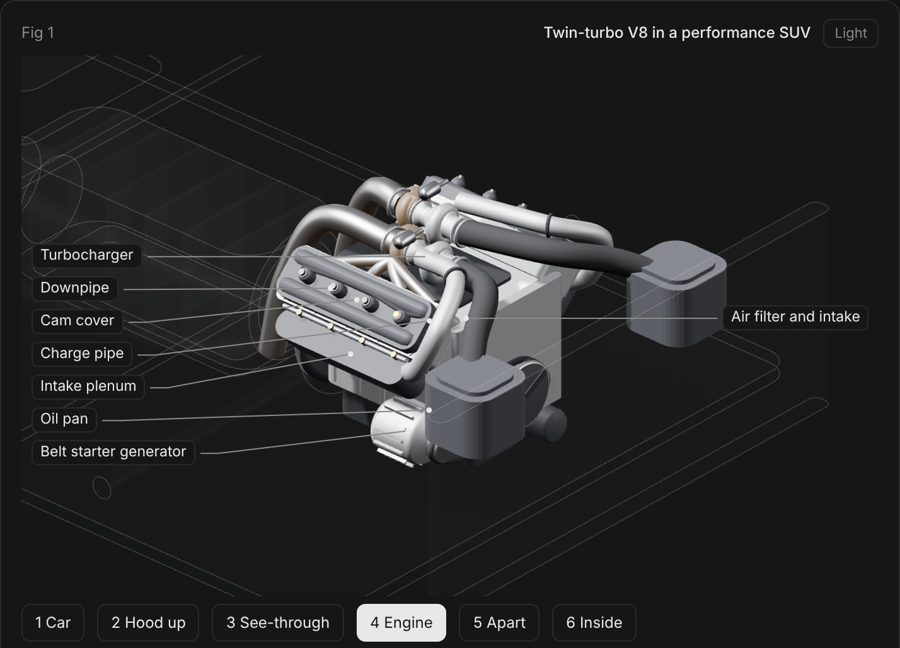
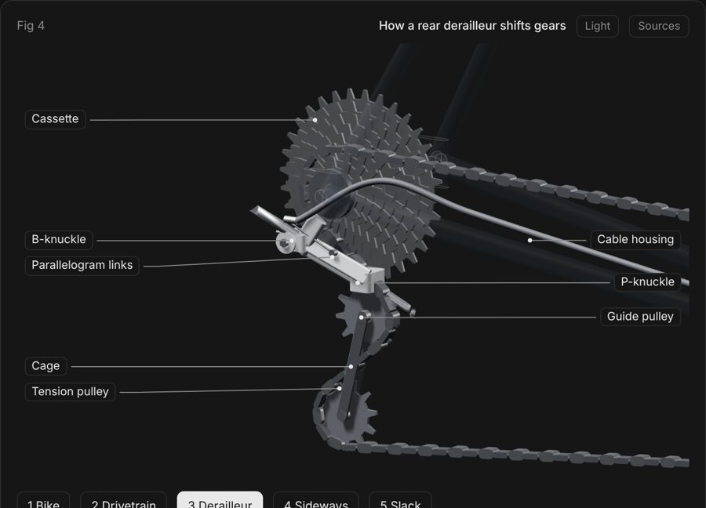
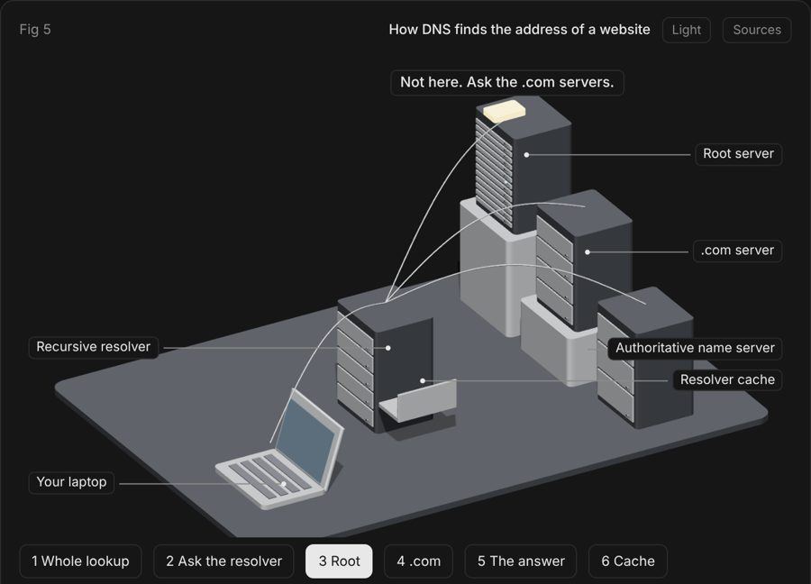
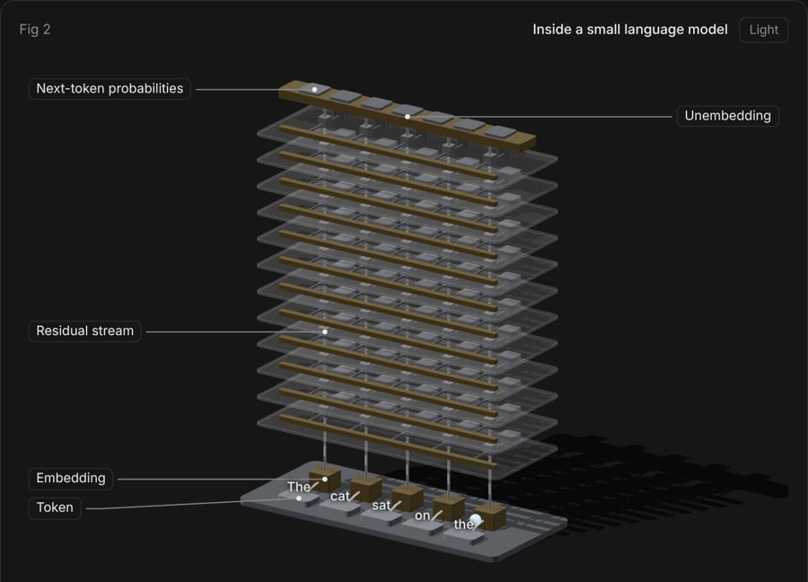
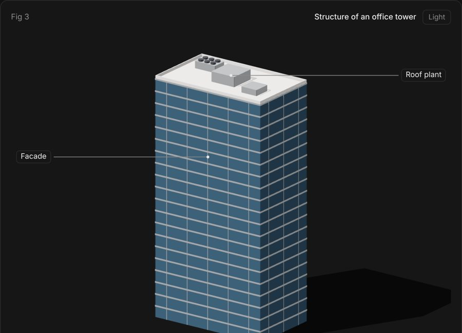

# mech

Interactive isometric figures that explain how a machine works by letting you open it up.

A figure is one HTML page. It runs on three.js with an orthographic camera and has two looks: a realistic one with metal, paint and rubber materials, and a line-drawing one with flat tones and edge lines. You step from the whole object to the mechanism inside it. A small model drives the motion and the readout, so the numbers are true.

## Gallery

Each picture links to the live figure. Open one, step through the stages, and click the parts.

| | |
|---|---|
| [](https://auswallace.github.io/mech/examples/v8-suv/) | [](https://auswallace.github.io/mech/examples/derailleur/) |
| Twin-turbo V8 in an SUV | How a rear derailleur shifts |
| [](https://auswallace.github.io/mech/examples/dns/) | [](https://auswallace.github.io/mech/examples/llm/) |
| How DNS finds an address | Inside a small language model |
| [](https://auswallace.github.io/mech/examples/tower/) | |
| Structure of a 20-storey tower | |

## Examples

- `examples/v8-suv`: a twin-turbo V8 in a performance SUV. Six stages from the whole car to the pistons and valves, a lesson on the four strokes, air and exhaust flow, and a quiz. The engine follows the published layout of a 4.0 litre, 90 degree, twin-turbo V8. The body is an original, generic shell.
- `examples/tower`: the structure of a 20-storey office tower. Slabs, beams, columns, core, lifts and piled foundation, a slider that builds it storey by storey, and the paths of weight and wind.
- `examples/derailleur`: how a rear derailleur shifts gears. Toothed cogs, a chain that follows a solved path, a parallelogram that swings, and a cage whose angle keeps the chain length constant. It carries a sourced facts list and 33 model checks.
- `examples/dns`: how DNS finds the address of a website. Five stations, eight readable messages, a cache that fills and expires.
- `examples/llm`: the inside of a small language model. Tokens, embeddings, 12 layers of attention and MLP, and the next-token output, with the sizes of GPT-2 small.

Every figure has labels, click-to-learn part info, a guided lesson, a quiz and a light and dark theme. The newer ones also have a Sources button that shows where each fact comes from.

```sh
npm install
node scripts/build.mjs examples/v8-suv          # writes examples/v8-suv/index.html
node scripts/build.mjs examples/v8-suv --light  # light theme
python3 scripts/capture.py examples/v8-suv/index.html shots   # screenshots of each stage (needs playwright and Chrome)
```

Open `index.html` in a browser. Number keys change stage, Space goes to the next stage, drag to orbit, click a part to learn what it does.

## Use as an agent skill

Copy or clone this repository into your agent's skills folder as `mech`. Then ask: "use mech to show me how a dishwasher works".

## Layout

- `SKILL.md`: the workflow and rules
- `kit/mech.js`: the renderer and parts
- `scripts/build.mjs`, `scripts/capture.py`: build and check
- `references/`: subject types, teaching layer, kit reference, craft notes, lessons learned
- `template/`: an empty scene to start from
- `evals/`: test prompts with pass criteria
- `ROADMAP.md`: what is done and what is next
- `examples/`: worked figures

MIT license.
